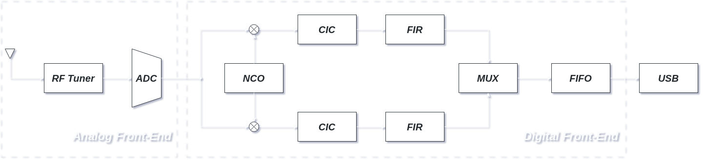

# SDR - Digital Front-End

This repository implements the Digital Front-End (DFE) of a Software Defined Radio (SDR) using VHDL. The design prioritizes a structural approach: foundational logic components, such as the Ripple-Carry Adder, are built from first principles rather than relying on behavioral modeling. As a result, this implementation serves as a didactic exploration of the core hardware components within an SDR's digital datapath. The only deliberate exception is the mixer's multiplier, which utilizes the standard `*` operator. A structural multiplier built from discrete adders would be significantly larger and slower than the dedicated DSP blocks that the synthesis tool can infer from the behavioral operator.

Despite this educational focus and lack of heavy optimization, the design is fully intended to be synthesized and executed on a physical FPGA (see [Known Limitations](#known-limitations)).

## General Architecture

The schematic illustrates the complete radio signal path. The left side represents the Analog Front-End (AFE). While fundamental to the radio's operation, the AFE is out of scope for this repository. This is due to the inherent limitations of standard hardware description languages, which cannot model continuous-time physical phenomena or analog components operating in linear regions. The expected output from the ADC (which acts as the input to this digital domain) is a single stream of real-valued, two's complement samples at the sampling rate `fs`.

The right side highlights the focus of this project, terminating at the USB block, which represents any external device or interface that consumes the processed SDR data.

<!--
The top and bottom branches of the DFE are the In-phase (I) and Quadrature (Q) outputs of a digital down-converter (DDC). Both branches receive the same ADC stream and mix it with the cosine and the (negated) sine generated by the NCO, which shifts the wanted channel from its intermediate frequency (IF) at the ADC down to complex baseband. The NCO frequency word can be set so that the channel lands at 0 Hz or at a small offset from it: an offset keeps the DC artefacts of the datapath (e.g. rounding bias) outside the channel, at the cost of a residual shift to be applied later.
-->

## Component Hierarchy

The primary modules implemented (located in `src/`) include:

<!--
*   **`NCO_module/NCO.vhd`:** (Numerically Controlled Oscillator) A phase accumulator utilizing phase truncation and a shared ROM lookup table to generate the local cosine and sine waves. The cosine is read from the same full-period sine table by offsetting the address by a quarter turn, which only modifies the two most significant address bits. Both outputs are registered, so they have the same latency.

*   **`Mixer_Branch.vhd`:** One mixer branch, which multiplies the ADC samples by a single NCO output (cosine or sine) and rounds the product to the output width. It is instantiated twice, once for I and once for Q; the `NEGATE` generic selects the multiplication by -sin for the Q branch. The latency is 3 clock cycles for both branches.

*   **`CIC.vhd`:** Cascaded Integrator-Comb filter, which performs the bulk of the sample rate reduction by a factor `R`. It is built from `N` integrators (an adder with a register in the feedback loop) running at the full rate, followed by `N` combs and a rounding stage running at `fs/R`, plus a sign extension at the input and a modulo-`R` counter. The decimation is performed with a clock enable (`en_dec`) rather than a divided clock, so that the whole filter stays in a single clock domain. A `valid` flag marks the clock cycles in which the output carries a new sample.

*   **`FIR.vhd`:** Finite Impulse Response filter, running at the reduced rate, which shapes the channel and compensates the passband droop of the CIC.

*   **`IQ_Interleaver.vhd`:** (shown as MUX in the schematic) Serializes the parallel I and Q streams from the filters into a single bus that alternates I, Q, I, Q, accompanied by a `valid` flag, for the FIFO buffer.

*   **`FIFO.vhd`:** A generic, structurally generated FIFO buffer that bridges the continuous DSP pipeline and burst-based PC interfaces. It is made of an array of `Mnum` words (`DFF`s with write enables), two modulo-`Mnum` counters as write and read pointers, and a read multiplexer. The `full` and `empty` flags come from comparing the pointers with the `Comparator`, so `Mnum` must be a power of two. It works on a single clock.

All utility modules used by the primary pipelines (e.g., `Phase_Accumulator`, `Comparator`, `RCA`, `DFF`) can be found in the `src/utility/` directory.

## Known Limitations

*   The structural `RCA` is built from gates, so the synthesis tool does not map it onto the dedicated carry chains of the FPGA. For wide adders it limits the maximum clock frequency.
*   If the `DFF` uses an asynchronous reset, its registers cannot be absorbed into the registers of the DSP blocks, which also lowers the maximum clock frequency of the mixer.
-->

## Testing

Testing is performed via structural ModelSim testbenches located in the `tb/` directory. Compile the files in `src/utility/` first, then the remaining ones. I will add the testbenches from time to time; if you need to verify the correctness of a module that doesn't have a tb yet, please [open an issue](../../issues/new).

<!--
Because we cannot synthesize the physical ADC, the testbenches act as a "Fake ADC": they inject pre-calculated arrays or read raw binary files representing the un-demodulated ADC output. Running them shows the resulting waveforms, which allow to verify that the phase accumulation, mixing, filtering and FIFO propagation maintain a cycle-accurate timing and preserve the data sequence.
-->

<!--
## How to Use

1.  Clone this repository and open the project in your preferred HDL simulator (e.g., ModelSim, Questa) or synthesis tool (e.g., Vivado, Quartus).
2.  Compile the source files in the `src/` directory, ensuring you use VHDL-2008 standard (or VHDL-93 with appropriate signal mapping).
3.  Instantiate the top-level DFE entity in your design, configuring the generics (e.g., `PHASE_W` for the NCO, `R` and `N` for the CIC, the depth of the FIFO).
4.  Map your physical FPGA pins (or simulated ADC input arrays) to the `adc_data_in` port.
-->

## Status

This project is currently **under development**. 

*   [x] Utilities (Comparator, Data Flip-Flop, Ripple-Carry Adder, Phase Accumulator)
*   [x] NCO / ROM Lookup Table (`NCO_module/`)
*   [x] DigitalMixer (`DigitalMixer_module/`)
*   [x] CIC Decimation Filter (`CIC_module/`)
*   [ ] FIR Filter (`FIR_module/`)
*   [x] I/Q Interleaver (`IQ_Interleaver.vhd`)
*   [ ] FIFO Buffer (`FIFO.vhd`)
*   [ ] Top-Level Pipeline Integration (`DFE_Wrapper.vhd`)
