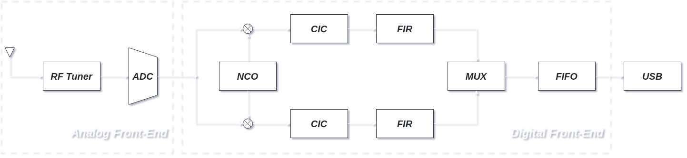

# SDR - Digital Front-End

This repository implements a Digital Front-End (DFE) hardware component for a Software Defined Radio (SDR) using VHDL. The design prioritizes a rigorous, structural approach, building foundational logic components (such as a generic N-bit Ripple-Carry Adder) from first principles rather than relying entirely on behavioral modeling.

The architecture is heavily optimized for real-time digital signal processing, ensuring the resulting RTL can be efficiently synthesized and routed onto physical FPGA fabric.

## General Architecture

The schematic illustrates the complete radio signal path. The left side represents the physical Analog Front-End (Antenna, LNA, RF Mixer, and Filters). Because standard hardware description languages cannot model continuous-time physical phenomena or analog components operating in linear regions, the Analog-to-Digital Converter (ADC) serves as the strict physical boundary for this project. 

The top and bottom branches of the Digital Front-End part represent the In-phase and Quadrature components of a generic quadrature modulated signal.

The right side highlights the repository's core focus: the custom VHDL Digital Front-End.

## Component Hierarchy

The DFE executes the digital down-conversion and data-packing pipelines. The primary top-level modules (located in `src/`) include:

*   **`NCO.vhd`:** (Numerically Controlled Oscillator) A parameterized phase accumulator and ROM lookup table that generates the local digital sine and cosine waves at the Intermediate Frequency (IF).

*   **`ComplexMixer.vhd`:** Structural DSP multipliers that mix the incoming ADC data stream with the NCO outputs to separate the signal into In-Phase (I) and Quadrature (Q) baseband components.

*   **`CIC.vhd`, `FIR.vhd`:** Cascaded Integrator-Comb (CIC) and Finite Impulse Response (FIR) filters to low-pass filter the baseband signals and downsample the high ADC clock rate to a manageable USB transfer rate.

*   **`IQ_Interleaver.vhd`:** A multiplexer that serializes the parallel In-Phase (I) and Quadrature (Q) data streams from the filters into a single interleaved bus for the FIFO buffer.

*   **`FIFO.vhd`:** A fully generic, structurally generated asynchronous shift-register buffer (using a custom 2D array and `for...generate` loops) to safely pack and bridge data between the continuous DSP pipeline and burst-based PC interfaces.

All utility modules used by the primary pipelines (e.g., `Phase_Accumulator`, `Comparator`, `RCA`, `DFF`) can be found in the `src/utility/` directory.

## Testing

Testing is performed via structural ModelSim testbenches located in the `tb/` directory. I will add the testbenches from time to time; if you need to verify the correctness of a module that doesn't have a tb yet, please [open an issue](../../issues/new).

<!--
Because we cannot synthesize the physical ADC, the testbenches act as a "Fake ADC." They inject pre-calculated arrays or read raw binary files representing the un-demodulated ADC output. You can run the testbenches to view the resulting waveforms, proving that the phase accumulation, complex mixing, and FIFO propagation maintain exact cycle-accurate timing and data sequence preservation.

## How to Use

1.  Clone this repository and open the project in your preferred HDL simulator (e.g., ModelSim, Questa) or synthesis tool (e.g., Vivado, Quartus).
2.  Compile the source files in the `src/` directory, ensuring you use VHDL-2008 standard (or VHDL-93 with appropriate signal mapping).
3.  Instantiate the top-level DFE entity in your design, configuring the generics (e.g., `Nbit`, `Mnum` for the FIFO depth, `PHASE_BITS` for the NCO).
4.  Map your physical FPGA pins (or simulated ADC input arrays) to the `adc_data_in` port.

-->

## Status

This project is currently **under development**. 

*   [x] Utilities (Comparator, Data Flip-Flop, Ripple-Carry Adder, Phase Accumulator)
*   [x] Parameterized FIFO Buffer (`FIFO.vhd`)
*   [ ] NCO / ROM Lookup Table (`NCO.vhd`)
*   [ ] I/Q Complex Mixer and Interleaver (`ComplexMixer.vhd`, `IQ_Interleaver.vhd`)
*   [ ] CIC / FIR Decimation Filters (`CIC.vhd`, `FIR.vhd`)
*   [ ] Top-Level Pipeline Integration (`DFE_Wrapper.vhd`)
